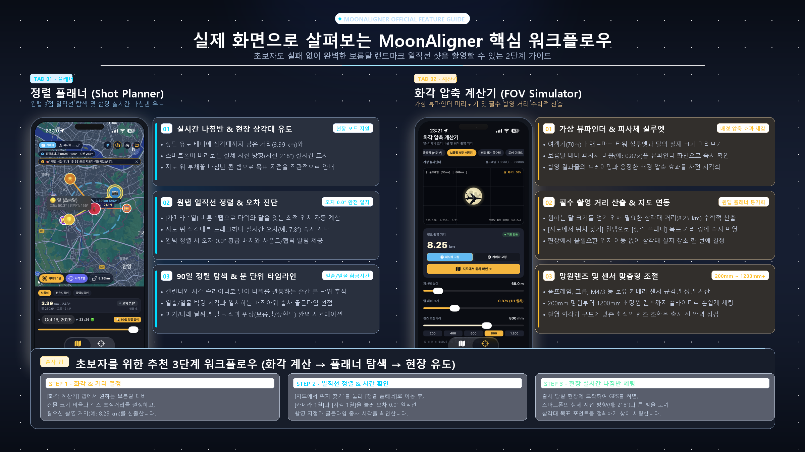

# 🌕 MoonAligner (문얼라이너)
> **완벽한 보름달과 랜드마크 정렬 출사를 위한 스마트 플래너 & 화각 압축 계산기**

[](https://github.com/zazunim/MoonAligner)
[](https://github.com/zazunim/MoonAligner/releases)
[](Android/)
[](iOS/)
[](LICENSE)

---



## 📌 프로젝트 소개
**MoonAligner**는 타워(랜드마크), 비행기 등 피사체 뒤로 거대한 보름달이 정확히 일치하여 떠오르거나 지는 **초망원 일직선 정렬 샷**을 초보자도 쉽게 계획하고 촬영할 수 있도록 돕는 모바일 출사 보조 애플리케이션입니다.

- **Android**: Kotlin & Jetpack Compose, Osmdroid, Sensor Framework
- **iOS**: Swift & SwiftUI, MapKit, CoreLocation, CoreMotion

---

## 🚀 빠른 다운로드 (Downloads)

| 플랫폼 | 설치 방법 | 다운로드 링크 |
| :--- | :--- | :--- |
| **Android** | 스마트폰에서 다운로드 후 바로 설치 (사이드로딩) | [📥 최신 MoonAligner.apk 다운로드](https://github.com/zazunim/MoonAligner/releases/latest) |
| **iOS (iPhone)** | Xcode 소스 빌드 또는 AltStore / Sideloadly 설치 | [📦 iOS 프로젝트 소스코드 (v1.0.0)](https://github.com/zazunim/MoonAligner/releases/latest) |

---

## ✨ 핵심 기능 (Key Features)

### 1. 🎯 정렬 플래너 (Shot Planner)
- **원탭 3점 일직선 탐색**: `[카메라 1열]` 탭 한 번으로 카메라(삼각대), 랜드마크(피사체), 달의 궤적이 오차 0.0°로 일치하는 최적 촬영 지점을 자동 산출합니다.
- **실시간 나침반 & 현장 유도**: 출사 현장에서 스마트폰이 바라보는 실제 시선 방향(예: `시선 218°`)과 나침반 부채꼴 콘 빔을 지도 위에 표시하여 삼각대 설치 포인트를 정확히 안내합니다.
- **오차 실시간 진단**: 현재 삼각대 위치의 각도 오차(예: `오차 7.8°` ➔ `오차 0.0° 완전 일치`)를 직관적인 배지와 색상으로 피드백합니다.
- **90일 타임라인 & 궤적 시뮬레이터**: 달력과 시간 슬라이더를 통해 달이 타워 정점을 통과하는 순간을 분 단위로 추적하며, 매직아워(일출/일몰 박명) 골든타임을 선점할 수 있습니다.

### 2. 🔭 화각 압축 계산기 (FOV Simulator)
- **가상 뷰파인더 미리보기**: 70m 여객기나 대형 타워 실루엣과 달의 실제 상대 크기 비율(예: `0.87×`)을 뷰파인더 화면으로 즉시 확인합니다.
- **배경 압축 효과 체감**: 풀프레임 기준 200mm 망원부터 1200mm+ 초망원 렌즈까지 슬라이더를 조절하며 프레임 안의 구도를 사전 시각화합니다.
- **필수 촬영 거리 수학적 산출**: 원하는 달 크기 비율을 얻기 위해 필요한 삼각대 거리(예: `8.25 km`)를 광학 공식으로 자동 계산합니다.
- **원탭 지도 연동**: `[지도에서 위치 찾기]` 버튼을 누르면 정렬 플래너의 목표 거리 링에 즉시 동기화되어 삼각대 위치를 바로 찾을 수 있습니다.

---

## 💡 추천 출사 워크플로우 (3 Steps)

```
[화각 계산기]                     [정렬 플래너]                     [출사 현장]
목표 달 크기 비율 결정    →    원탭 일직선 지점 탐색    →    실시간 나침반(시선 방향) 유도
필수 촬영 거리 산출(8.25km)     출사 일시 & 골든타임 확인          삼각대 세팅 및 셔터 찬스
```

---

## 🛠️ 프로젝트 빌드 방법

### Android
```bash
cd Android
./gradlew assembleRelease
# 빌드 결과물: Android/app/build/outputs/apk/release/app-release.apk
```

### iOS
1. macOS 환경에서 `iOS/MoonAligner.xcodeproj`를 Xcode로 엽니다.
2. 타깃 기기(본인 iPhone 또는 시뮬레이터)를 선택합니다.
3. `Cmd + R`을 눌러 빌드 및 실행합니다.

---

## 📄 라이선스 (License)
본 프로젝트는 [MIT License](LICENSE)를 따릅니다.
누구나 자유롭게 수정 및 배포할 수 있습니다.
